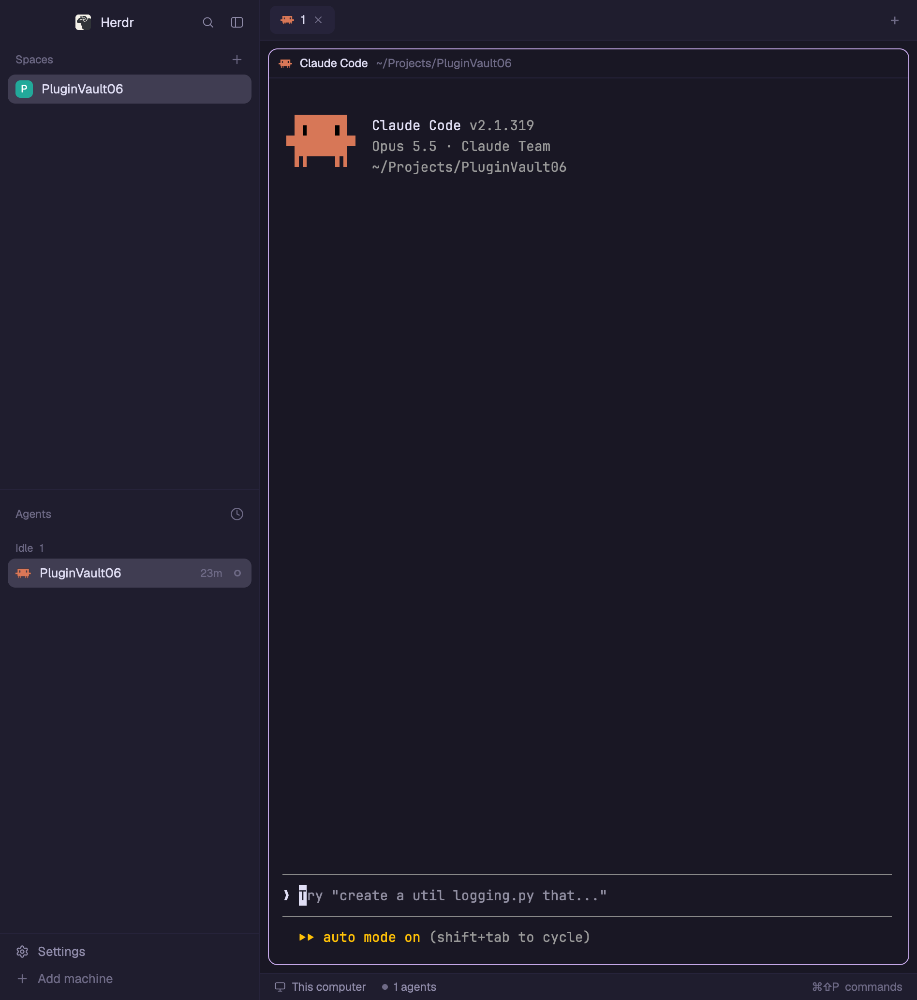

# Rose Pine for Herdr

A [Herdr](https://herdr.dev) desktop app layout: the default window in the soho-vibes Rosé Pine palette.



## Install

Ask your agent:

> Add the Herdr layout from https://github.com/mustafaergul/herdr-rose-pine

Or by hand:

```sh
git clone https://github.com/mustafaergul/herdr-rose-pine
cp herdr-rose-pine/layouts/rose-pine.* ~/.config/herdr-app/layouts/
herdr-app do layout.switch --name rose-pine
```

Switch back any time with `herdr-app do layout.switch --name main`, or from Settings → Layouts.

### Just the colors

`themes/rose-pine.json` is the same palette as a theme file. To use it on any layout:

```sh
cp herdr-rose-pine/themes/rose-pine.json ~/.config/herdr-app/themes/
herdr-app do app.theme --name rose-pine
```

## Files

- `layouts/rose-pine.json`: the layout (Herdr's default structure, Rose Pine colors built in)
- `layouts/rose-pine.svg`: its picture in Settings
- `themes/rose-pine.json`: the palette on its own
- `RECIPE.md`: how to rebuild it from scratch

Palette: [Rose Pine](https://rosepinetheme.com). MIT licensed.
