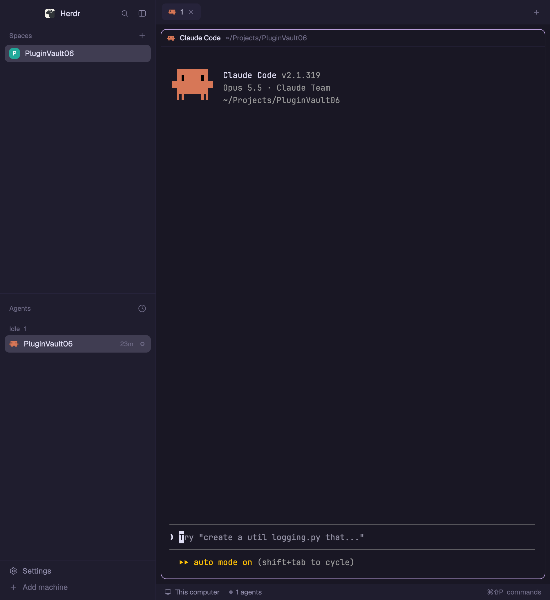

# Rose Pine

Herdr's default window (spaces and agents sidebar, tab bar, bordered terminal panes, status bar) painted in the soho-vibes Rosé Pine palette. Nothing moves or changes shape compared with the shipped `main` layout; every panel, terminal and agent dot takes its color from Rose Pine.

## What you see

Left to right, with the window's own title bar hidden (`"titlebar": "none"`, macOS buttons at `[12, 16]`):

- **Sidebar**, 268px wide (44–480), background `chrome` `#1f1d2e`, a 1px `#26233a` divider on its right.
  - Brand row, 46px: the app name and search/sidebar buttons. Dragging it moves the window.
  - **Spaces** and **Agents** lists, splitting the remaining height evenly (each at least 90px). The selected row is `#403d52`, hover `#26233a`, text `#e0def4`, secondary text `#908caa`, section labels `#6e6a86`.
  - Footer, 69px: Settings and Add machine.
- **Work area**, background `canvas` `#191724`:
  - Tab bar, 42px, draggable. The active tab sits on `raised` `#26233a`.
  - Panes, inset 8px with 8px gaps, 10px corner radius, terminal background `#191724`, 1px `#26233a` border, 1px `#c4a7e7` (iris (lilac)) border on the focused pane. Each pane has a 30px header (program and folder), always shown.
  - Terminal text `#e0def4`, selection `#403d52`, cursor `#e0def4`, padding 14×12px. The 16 ANSI colors, ansi0 to ansi15: `#26233a`, `#eb6f92`, `#31748f`, `#f6c177`, `#9ccfd8`, `#c4a7e7`, `#ebbcba`, `#e0def4`, `#6e6a86`, `#eb6f92`, `#31748f`, `#f6c177`, `#9ccfd8`, `#c4a7e7`, `#ebbcba`, `#e0def4`. Rosé Pine has no true green: ansi2/ansi10 are pine `#31748f`.
  - A files/changes side panel, 368px (280–900), hidden until opened.
  - Status bar, 28px: machine, agent count, command hint.

Fonts are left unset, so Herdr's defaults apply (JetBrains Mono 14 in terminals, Geist in panels) unless the person's settings say otherwise.

## How it behaves

- Agent dots and status text: **working** `#f6c177`, **blocked** `#eb6f92`, **done** `#9ccfd8` (foam), **idle** and **unknown** `#6e6a86`.
- Clicks, keys, hovers and resizing are exactly the shipped `main` layout's; this layout adds no mods and no keys.
- Popovers and menus use `popover` `#26233a`, inputs `#403d52`, focus rings `#c4a7e7`, accent buttons `#c4a7e7` with `#191724` text.

## Built from

- `layouts/rose-pine.json`: a copy of the shipped `layouts/main.json` node tree (`root` row → `sidebar` column [`brand`, `sidebar-lists` (`spaces`, `agents`), `sidebar-footer`] + `work` column [`tabs`, `work-body` row (`main` tab block, hidden `panel` stack of `files`/`changes`), `status`]).
- Shipped mods only: `workspace-chrome`, `spaces`, `agents`, `tabs`, `pane`, `files`, `changes`, `workspace-status`.
- The look lives on the root: `"theme": "graphite"` as the base, and `"colors"` overriding every theme color plus `background`, `terminal_foreground`, `selection`, `cursor` and `ansi0`–`ansi15`. That makes the layout self-contained: no `themes/` file is needed.
- `layouts/rose-pine.svg`: the 320×200 picture Settings shows for the layout (`"preview"`).
- Optional extra: `themes/rose-pine.json`, the same palette as a theme file, for `app.theme rose-pine` on any other layout.

## Watch out

- Overrides apply in both appearances, so this is a dark-only look; a light system appearance still shows it dark.
- The theme picker in Settings overrides a layout's look. If the colors don't appear, pick the layout's own theme again or clear the picker.
- Copy the root's `colors` in full: dropping the `ansi*` keys leaves graphite's terminal colors.
- `"preview"` points at `layouts/rose-pine.svg`; if only the JSON is copied, Settings shows a plain card.

## Done when

- `herdr-app do layout.switch --name rose-pine` returns ok and `herdr-app status` shows `"layout": "rose-pine"` with `"errors": []`.
- The sidebar is `#1f1d2e`, the terminal background `#191724`, and the focused pane has a `#c4a7e7` border.
- `printf '\e[31mred \e[32mgreen \e[34mblue\e[0m\n'` in a terminal prints `#eb6f92`, `#31748f` and `#9ccfd8`.
- A blocked agent's dot is `#eb6f92`; a finished one is `#9ccfd8`.
- Settings → Layouts shows the Rose Pine preview card.
